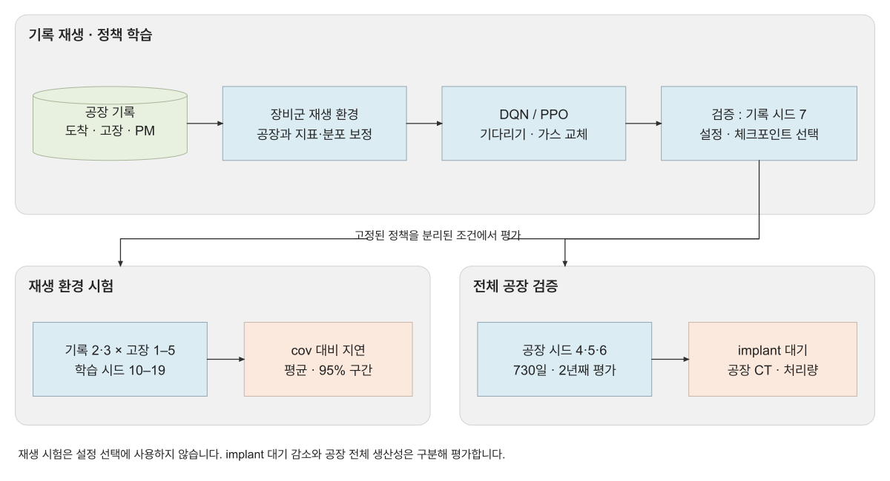
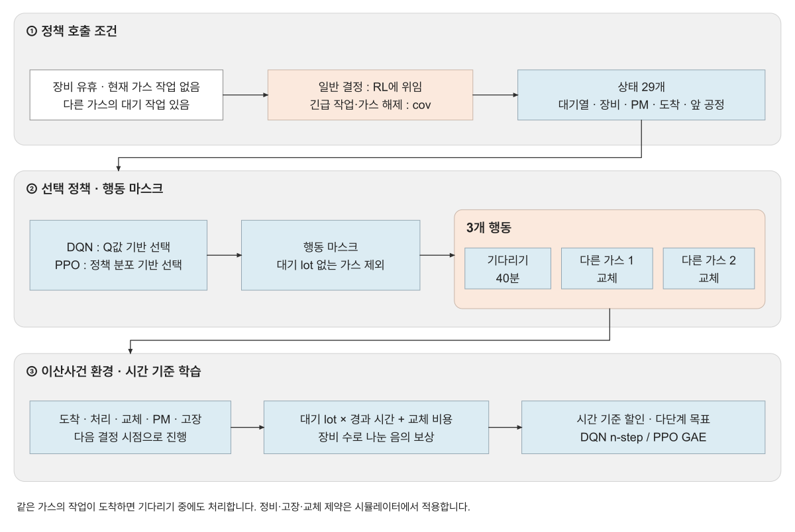
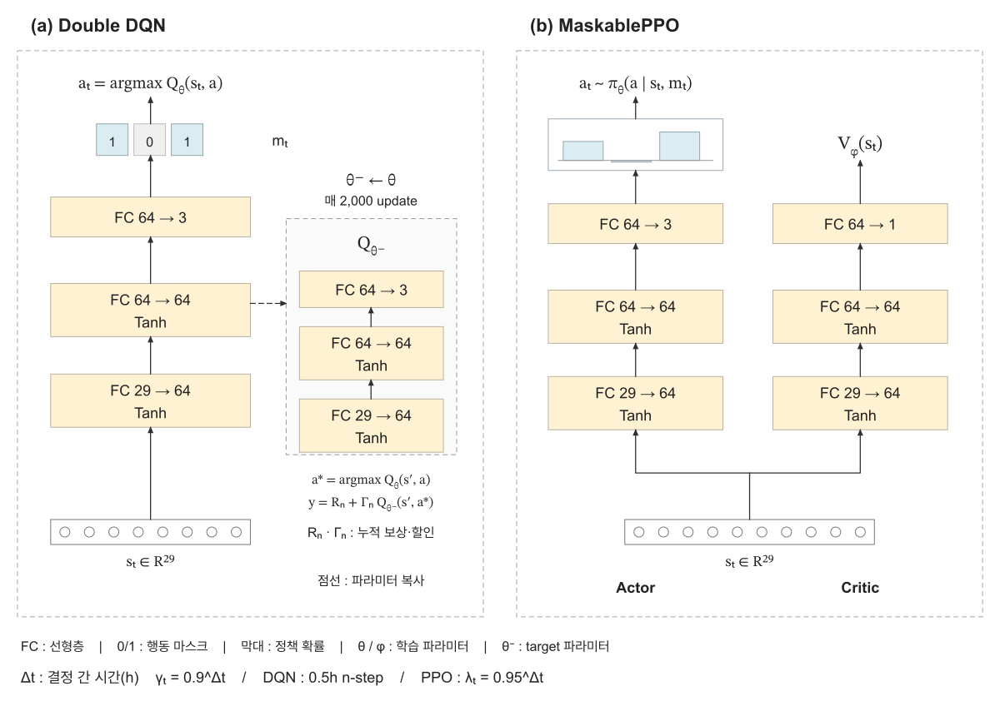
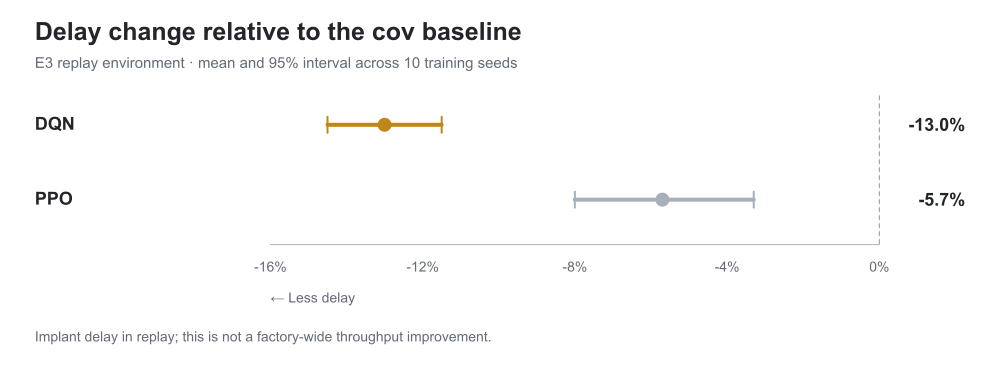

# Fab 가스 교체 최적화

반도체 이온 주입 공정에서 현재 가스의 작업을 기다릴지, 다른 가스로 교체할지 결정하는 강화학습 프로젝트입니다. 공장 기록으로 보정한 재생 환경에 29차원 상태·3개 행동과 시간 기준 보상을 구성하고 DQN·PPO를 비교했습니다. 분리된 시험 조건에서 DQN은 압력 규칙 `cov` 대비 전체 지연을 평균 13.0% 줄였습니다. 전체 공장 재검증에서도 implant 대기는 감소했으나 공장 CT·처리량의 뚜렷한 개선까지 확인한 것은 아닙니다.

강화학습개론 팀 프로젝트 · Python · Double DQN · MaskablePPO · 이산사건 시뮬레이션

[실험 설계](https://github.com/912eun/26-2-rl-project-fab/blob/develop/docs/EXPERIMENT_PLAN.md) · [실험 결과·한계](https://github.com/912eun/26-2-rl-project-fab/blob/develop/docs/STATUS.md) · [공정 인터랙티브 설명](https://claude.ai/artifact/8D2UrQMXGViHDASqqgaEtV)

[공장 풀가동!](https://github.com/912eun/insicon-ai-mcs)의 AMR 운반·충전 제어에 이어, 장비의 가스 교체 시점과 결정 간격이 불규칙한 환경의 학습을 다룬 후속 프로젝트입니다.

> 아래 결과와 실행 안내는 `develop` 브랜치의 E3·E6 실험 기준입니다. 코드를 실행할 때도 `develop`을 사용합니다.

## 01. 문제

이온 주입 장비는 가스를 교체하는 동안 생산할 수 없습니다. 현재 가스의 대기 작업이 없을 때 즉시 교체하면 곧 도착할 같은 가스 작업 때문에 다시 교체할 수 있고, 너무 오래 기다리면 다른 작업의 지연이 누적됩니다.

| 장비군 | 장비 수 | 가스 교체 시간 |
|---|---:|---:|
| Implant_128 | 10대 | 72분 |
| Implant_132 | 8대 | 60분 |
| Implant_91 | 6대 | 80분 |

최소 연속 처리량, 정비(PM), 고장, 긴급 작업을 반영합니다. RL은 장비가 비었고 현재 가스의 작업은 없지만 다른 가스의 작업이 있는 순간에 개입합니다. 긴급 작업이나 정비 후 가스가 해제된 상태는 기준 규칙으로 처리합니다.

## 02. 학습·검증 구조



작은 환경에서는 같은 도착 기록을 반복 사용해 정책을 비교합니다. 공장과 대기·교체 횟수·가동률·상태 분포를 대조하고, 규칙을 바꿨을 때 결과가 같은 방향으로 움직이는지도 확인했습니다. 여러 장비군을 동시에 제어하면 공정 간 도착 흐름이 바뀌므로, 재생 환경의 결과만으로 결론을 내리지 않고 공장 전체 검증을 추가했습니다.

### 상태 S · 행동 A · 보상 R



| 항목 | 설계 |
|---|---|
| 상태 S (29차원) | 장비군 크기·교체 시간, 대기·PM 잔여량, 가스별 다른 장비 상태·대기 작업·긴급 작업·도착 정보 및 앞 공정 6개 변수 |
| 행동 A (Discrete(3)) | `0`: 기다리기 / `1`: 다른 가스 1 / `2`: 다른 가스 2. 대기 작업이 없는 가스는 마스킹 |
| 보상 R (누적 비용 변화) | 대기 작업 수 × 경과 시간의 적분 + 발생한 교체 시간. 장비 수와 시간 단위로 정규화한 음의 보상 |
| 시간 처리 | 결정 사이 경과 시간에 따라 할인·다단계 목표 적용 |
| 최종 기다리기 길이 | 검증 비교를 통해 40분 선택 |

$$
C(\tau)=\int_0^\tau N_{\mathrm{queue}}(u)\,du + \sum_{k:\tau_k\leq\tau} T_{\mathrm{setup},k},
\qquad r_t=-\frac{C(\tau_{t+1})-C(\tau_t)}{3600M}
$$

`M`은 장비군의 장비 수입니다. 대기 적분과 교체 시간은 초 단위로 누적하고 3,600으로 나눠 시간 단위로 맞춥니다. 두 알고리즘 모두 학습에는 보상 `×0.1`을 사용합니다. 결정 간격이 일정하지 않으므로 할인은 `γₜ = 0.9^Δt(h)`, PPO의 GAE는 `λₜ = 0.95^Δt(h)`로 계산합니다.

### 네트워크 계층



### 하이퍼파라미터

| 항목 | DQN | PPO |
|---|---|---|
| 네트워크 | `29 → 64 → 64 → 3`, Tanh | Actor `29 → 64 → 64 → 3`, Critic `29 → 64 → 64 → 1`, Tanh |
| 학습률 | `1e-4` 고정 | `3e-4`, 600 rollout에 걸쳐 감소·하한 10% |
| 환경 수 / mini-batch | 8 / 256 | 8 / 256 |
| 학습 상한 | 1,200,000 환경 step | 1,000 rollout, 환경당 256 step |
| 업데이트 | 환경 4 step마다 1회 | rollout당 4 epoch |
| Replay / 초기 수집 | 200,000 / 10,000 step | 해당 없음 |
| Target network | 2,000 gradient update마다 복사 | 해당 없음 |
| 탐색 | ε 1 → 0.05, 360,000 step; 교체 탐색률 0.6/시간 | 초기 교체율 0.3/시간, entropy 0.003 → 0 |
| 장기 보상 | 시간 기준 n-step 0.5h | 시간 기준 GAE λ=0.95/시간 |
| 손실·제약 | Smooth L1, gradient clip 10 | PPO clip 0.2, value 계수 0.5, gradient clip 0.5 |
| 조기 종료 | 최종 설정은 사용 안 함 | 최소 600 rollout 이후 patience 15, min_delta 0.01 |
| 공통 | 기다리기 40분, γ=0.9/시간, 학습 시드 10~19 | 동일 |

최종 설정은 [E3 실험 기록](https://github.com/912eun/26-2-rl-project-fab/blob/develop/docs/STATUS.md)과 학습 스크립트 기준입니다. 초기 v4 결과와 최종 E3 설정을 구분합니다.

기준선 `cov`는 가스별 대기량 ÷ 해당 가스 담당 장비 수를 이용한 압력 규칙입니다. 단순 즉시 교체 규칙뿐 아니라 이 강한 기준선과 비교했습니다.

## 03. 실험 결과



*E3: 설정 조정에 쓰지 않은 학습 시드 10~19의 평균. 시험은 기록 시드 2·3 × 고장 시드 1~5 조건이며, 음수일수록 지연이 감소했습니다.*

| 알고리즘 | cov 대비 전체 지연 변화 | 95% 구간 |
|---|---:|---:|
| DQN | −13.0% | [−14.5%, −11.5%] |
| PPO | −5.7% | [−8.0%, −3.3%] |

검증 점수 평균은 DQN 0.810, PPO 0.883으로 DQN이 우세해 주 알고리즘으로 선택했습니다. 선택 규칙은 시험 결과가 나온 뒤 문서화되었으며, 실제 선택에는 검증 점수를 사용했다는 절차상의 한계를 함께 기록했습니다.

### 전체 공장 검증

E6는 검증 점수로 고른 DQN 정책을 공장 시드 4·5·6에 적용하고, 730일 실행 중 두 번째 해의 통계를 비교한 실험입니다.

| 세 장비군 동시 적용 | 시드 4 | 시드 5 | 시드 6 |
|---|---:|---:|---:|
| implant 전체 대기 변화 | −13.1% | −16.3% | −10.3% |

implant 대기는 줄었지만 공장 전체 생산성의 뚜렷한 개선까지 확인한 것은 아닙니다. DQN의 공장 CT 차이는 평균 −0.08일로 시드 간 변동 약 0.45일보다 작았고, 처리량 차이는 ±0.8% 이내였습니다. 장비군을 하나씩 제어하는 조건에서는 다른 장비군의 대기가 늘어나는 경우도 있었습니다.

PPO의 공장 검증은 보조 결과입니다. 검증으로 선택된 PPO 정책이 시험 성능에서도 10개 중 가장 좋았기 때문에 전체 PPO 평균보다 낙관적일 수 있습니다. 상세 표는 [진행 기록](https://github.com/912eun/26-2-rl-project-fab/blob/develop/docs/STATUS.md)에 있습니다.

## 04. 시행착오

| 문제 | 확인한 원인 | 반영 |
|---|---|---|
| 교체가 과도하게 발생 | 결정 횟수에 비례한 탐색이 실제 경과 시간을 반영하지 못함 | 시간 기준 탐색·할인·다단계 목표 |
| 기다리기로 정책 붕괴 | 드문 교체의 장기 효과를 학습하기 어려움 | 다단계 목표와 기다리기 길이 비교 |
| 재생·공장 지표 차이 | 고장 난수와 공정 간 피드백 영향 | 같은 고장 기록으로 보정, 공장 재검증 |
| 장시간 학습 중 메모리 증가 | 반복 검증 프로세스의 메모리 누적 | 검증 작업 단위로 프로세스 재생성 |

## 05. 실행

```bash
git clone --branch develop https://github.com/912eun/26-2-rl-project-fab.git
cd 26-2-rl-project-fab
python3 -m venv .venv
source .venv/bin/activate
pip install -r requirements.txt

# 저장된 도착 기록으로 기준선과 환경 재현성 확인
python3 baselines/run_baselines.py
python3 calibration/check_fidelity.py
```

최종 설정으로 DQN·PPO의 학습 시드 10~19를 재현하는 명령입니다. 실행 시간이 길며, 설정 선택에 사용한 시드 0~4와 분리합니다.

```bash
for seed in {10..19}; do
  python3 experiments/dqn_implant.py \
    --steps 1200000 --eps_steps 360000 \
    --nstep_h 0.5 --explore_rate_h 0.6 \
    --wait_min 40 --suffix _e3 --seed "$seed"
done

for seed in {10..19}; do
  python3 experiments/ppo_sb3.py \
    --iters 1000 --decay_iters 600 --lr_floor 0.1 \
    --min_iters 600 --patience 15 --min_delta 0.01 \
    --wait_init_rate_h 0.3 --ent 0.003 --ent_end 0 \
    --wait_min 40 --suffix _e3 --seed "$seed"
done

# 설정 선택에 쓰지 않은 시험 기록에서 평가
python3 experiments/evaluate.py --kind dqn --wait_min 40 \
  --models "results/rl_dqn/dqn_up_e3_s1?.pt"
python3 experiments/evaluate.py --kind ppo --stoch --wait_min 40 \
  --models "results/rl_ppo/ppo_up_lt_e3_s1?.pt"
python3 experiments/analyze.py
```

전체 공장 실행은 별도 시뮬레이터 설치와 긴 실행 시간이 필요합니다. 팀 실험의 설정·평가 순서는 [실험 안내서](https://github.com/912eun/26-2-rl-project-fab/blob/develop/docs/EXPERIMENT_PLAN.md)를 따릅니다.

```bash
./setup_simulator.sh
PATTERN=_e3 ALGS="dqn ppo" WAIT_MIN=40 SCOPE=both \
  bash experiments/run_fab_final.sh
```

`pick_policy.py`가 검증 점수로 각 알고리즘의 정책을 고릅니다. E3는 `results/rl_dqn/`, `results/rl_ppo/`, 공장 검증은 `results/implant_setup/`에 결과를 남깁니다. 보고된 실행에서는 DQN s11·PPO s12가 선택되었으며, 재학습 결과에 따라 선택 시드는 달라질 수 있습니다.

## 06. 코드와 출처

| 경로 (`develop`) | 내용 |
|---|---|
| `src/implant_env.py`, `implant_gym.py`, `implant_state.py` | 재생 환경·상태·행동·보상 |
| `calibration/` | 공장과 재생 환경의 재현성 비교 |
| `experiments/dqn_implant.py`, `ppo_sb3.py` | Double DQN·MaskablePPO |
| `experiments/pick_policy.py`, `run_fab_final.sh` | 검증 정책 선택·공장 검증 |
| `results/figures/` | E3·E6 결과 그림 |
| `docs/` | 실험 계획·공정 설명·결과 기록 |

공정 벤치마크: Kopp, Hassoun, Kalir & Mönch, SMT2020, IEEE TSM 33(4), 2020. 시뮬레이터: [PySCFabSim-revised](https://github.com/david-dd/PySCFabSim-revised), 사용 기준 커밋 `ae3d55e`. 외부 시뮬레이터는 저장소에 복사하지 않고 설치 스크립트로 받습니다.
